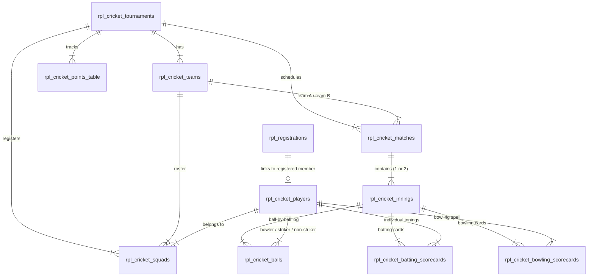

# 🏏 RPL Cricket Features — Database Schema & Architecture

> **Document Status:** Active Specification  
> **Scope:** Native RPL Cricket Features (Live Scoring, Match Scorecards, Leaderboards, Points Table, Squads & OBS Overlays).  
> **Note:** Excludes legacy CricHeroes scraping and historical data imports. All tables are designed to run alongside the existing RPL registration schema.

---

## Table of Contents

1. [Architectural Overview](#1-architectural-overview)
2. [Entity Relationship Diagram](#2-entity-relationship-diagram)
3. [Table Specifications](#3-table-specifications)
   - [rpl_cricket_tournaments](#1-rpl_cricket_tournaments)
   - [rpl_cricket_teams](#2-rpl_cricket_teams)
   - [rpl_cricket_players](#3-rpl_cricket_players)
   - [rpl_cricket_squads](#4-rpl_cricket_squads)
   - [rpl_cricket_matches](#5-rpl_cricket_matches)
   - [rpl_cricket_innings](#6-rpl_cricket_innings)
   - [rpl_cricket_balls](#7-rpl_cricket_balls-live-scoring-engine)
   - [rpl_cricket_batting_scorecards](#8-rpl_cricket_batting_scorecards)
   - [rpl_cricket_bowling_scorecards](#9-rpl_cricket_bowling_scorecards)
   - [rpl_cricket_points_table](#10-rpl_cricket_points_table)
4. [Complete MySQL DDL Script](#4-complete-mysql-ddl-script)
5. [Feature Data Flows](#5-feature-data-flows)
   - [Live Scoring & WebSocket Broadcast](#51-live-scoring--websocket-broadcast)
   - [Leaderboards (Orange / Purple Cap)](#52-leaderboards-orange--purple-cap)
   - [Points Table & Net Run Rate (NRR)](#53-points-table--net-run-rate-nrr)
   - [OBS Studio Live Score Ticker](#54-obs-studio-live-score-ticker)
6. [Linkage with Existing Registration Database](#6-linkage-with-existing-registration-database)

---

## 1. Architectural Overview

The RPL Cricket Engine runs on the existing MySQL instance alongside the registration tables (`rpl_sports`, `rpl_registration_fields`, and `rpl_registrations`).

All cricket tables use the prefix `rpl_cricket_` to maintain complete modular isolation:

* **No legacy scraping dependencies:** No external scrapers or unstable third-party IDs.
* **Granular Ball-by-Ball Logging:** Powers real-time websocket broadcasting, live commentary, and auditability.
* **Pre-Aggregated Scorecards:** Generates lightning-fast scorecard and leaderboard responses without slow on-the-fly table scans.
* **Deterministic Overs Calculation:** Avoids decimal floating-point math issues by storing `legal_balls_bowled` as integer counters.

---

## 2. Entity Relationship Diagram



---

## 3. Table Specifications

### 1. `rpl_cricket_tournaments`
Defines tournament seasons and rule configurations (e.g., T10, 10 overs/side).

| Column | Type | Constraints | Description |
|---|---|---|---|
| `id` | VARCHAR(36) | PRIMARY KEY | UUID v4 identifier |
| `name` | VARCHAR(100) | NOT NULL | Tournament display name (e.g. *RPL Season 9 Cup*) |
| `season_name` | VARCHAR(50) | NOT NULL DEFAULT 'RPL Season 9' | Season category |
| `format` | ENUM | 'T10', 'T20', 'BOX', 'CUSTOM' | Playing format |
| `overs_per_side` | INT | NOT NULL DEFAULT 10 | Max overs per innings |
| `status` | ENUM | 'upcoming', 'active', 'completed' | Tournament status |
| `created_at` | TIMESTAMP | DEFAULT CURRENT_TIMESTAMP | Record creation timestamp |

---

### 2. `rpl_cricket_teams`
Participating teams in the tournament.

| Column | Type | Constraints | Description |
|---|---|---|---|
| `id` | VARCHAR(36) | PRIMARY KEY | UUID v4 identifier |
| `tournament_id` | VARCHAR(36) | FK -> `rpl_cricket_tournaments.id` | Tournament scope |
| `name` | VARCHAR(100) | NOT NULL | Full team name (e.g. *Royal Strikers*) |
| `short_name` | VARCHAR(10) | NOT NULL | Abbreviation for scoreboard/ticker (e.g. *RS*) |
| `logo_url` | VARCHAR(500) | NULL | URL to team logo graphic |
| `color_code` | VARCHAR(20) | DEFAULT '#00E5FF' | Hex color for UI badges & OBS theme |
| `created_at` | TIMESTAMP | DEFAULT CURRENT_TIMESTAMP | Record creation timestamp |

---

### 3. `rpl_cricket_players`
Individual player records. Connects directly to the member's registration record if they submitted via the RPL portal.

| Column | Type | Constraints | Description |
|---|---|---|---|
| `id` | VARCHAR(36) | PRIMARY KEY | UUID v4 identifier |
| `registration_id` | VARCHAR(36) | FK -> `rpl_registrations.id` (NULLABLE) | Link to RPL portal registration |
| `full_name` | VARCHAR(100) | NOT NULL | Player display name |
| `phone` | VARCHAR(20) | NULL | Contact mobile number |
| `role` | ENUM | 'batsman', 'bowler', 'all_rounder', 'wicket_keeper' | Primary cricket discipline |
| `batting_style` | VARCHAR(50) | DEFAULT 'Right Hand Bat' | Batting style |
| `bowling_style` | VARCHAR(50) | DEFAULT 'Right Arm Medium' | Bowling style |
| `photo_url` | VARCHAR(500) | NULL | Player profile picture |
| `created_at` | TIMESTAMP | DEFAULT CURRENT_TIMESTAMP | Record creation timestamp |

---

### 4. `rpl_cricket_squads`
Tournament rosters assigning players to teams.

| Column | Type | Constraints | Description |
|---|---|---|---|
| `id` | VARCHAR(36) | PRIMARY KEY | UUID v4 identifier |
| `tournament_id` | VARCHAR(36) | FK -> `rpl_cricket_tournaments.id` | Tournament scope |
| `team_id` | VARCHAR(36) | FK -> `rpl_cricket_teams.id` | Assigned team |
| `player_id` | VARCHAR(36) | FK -> `rpl_cricket_players.id` | Player |
| `is_captain` | BOOLEAN | DEFAULT FALSE | Captain designation |
| `is_vice_captain` | BOOLEAN | DEFAULT FALSE | Vice-captain designation |
| `jersey_number` | INT | NULL | Squad jersey number |
| `created_at` | TIMESTAMP | DEFAULT CURRENT_TIMESTAMP | Assignment timestamp |

*Constraint:* `UNIQUE KEY (tournament_id, player_id)` prevents assigning a player to multiple squads in the same tournament.

---

### 5. `rpl_cricket_matches`
Fixtures, toss details, match statuses, and OBS stream tokens.

| Column | Type | Constraints | Description |
|---|---|---|---|
| `id` | VARCHAR(36) | PRIMARY KEY | UUID v4 identifier |
| `tournament_id` | VARCHAR(36) | FK -> `rpl_cricket_tournaments.id` | Tournament scope |
| `match_number` | INT | NOT NULL | Sequential match index |
| `stage` | VARCHAR(50) | DEFAULT 'League' | 'League', 'Quarter-Final', 'Semi-Final', 'Final' |
| `team_a_id` | VARCHAR(36) | FK -> `rpl_cricket_teams.id` | Team A |
| `team_b_id` | VARCHAR(36) | FK -> `rpl_cricket_teams.id` | Team B |
| `venue` | VARCHAR(100) | DEFAULT 'RPL Main Ground' | Ground location |
| `match_datetime` | DATETIME | NULL | Scheduled start time |
| `overs_per_side` | INT | NOT NULL DEFAULT 10 | Match overs per team |
| `toss_winner_team_id` | VARCHAR(36) | FK -> `rpl_cricket_teams.id` (NULLABLE) | Team winning the toss |
| `toss_decision` | ENUM | 'bat', 'bowl' | Decision taken |
| `status` | ENUM | 'upcoming', 'live', 'innings_break', 'completed', 'abandoned' | Live state |
| `winner_team_id` | VARCHAR(36) | FK -> `rpl_cricket_teams.id` (NULLABLE) | Match winner |
| `result_summary` | VARCHAR(255) | NULL | e.g. "Tigers won by 18 runs" |
| `player_of_the_match_id` | VARCHAR(36) | FK -> `rpl_cricket_players.id` (NULLABLE) | Best performer award |
| `stream_overlay_token` | VARCHAR(64) | UNIQUE | Secure token for OBS Live Ticker URL |
| `created_at` | TIMESTAMP | DEFAULT CURRENT_TIMESTAMP | Fixture creation timestamp |

---

### 6. `rpl_cricket_innings`
High-level summary of each innings in a match.

| Column | Type | Constraints | Description |
|---|---|---|---|
| `id` | VARCHAR(36) | PRIMARY KEY | UUID v4 identifier |
| `match_id` | VARCHAR(36) | FK -> `rpl_cricket_matches.id` | Parent match |
| `innings_number` | TINYINT | NOT NULL (1 or 2) | Innings index |
| `batting_team_id` | VARCHAR(36) | FK -> `rpl_cricket_teams.id` | Batting team |
| `bowling_team_id` | VARCHAR(36) | FK -> `rpl_cricket_teams.id` | Bowling team |
| `total_runs` | INT | DEFAULT 0 | Accumulated score |
| `total_wickets` | INT | DEFAULT 0 | Total wickets fallen |
| `legal_balls_bowled` | INT | DEFAULT 0 | Legal delivery count (overs = legal_balls/6) |
| `extras_wides` | INT | DEFAULT 0 | Wide ball runs |
| `extras_noballs` | INT | DEFAULT 0 | No-ball runs |
| `extras_byes` | INT | DEFAULT 0 | Byes runs |
| `extras_legbyes` | INT | DEFAULT 0 | Leg-byes runs |
| `is_completed` | BOOLEAN | DEFAULT FALSE | Indicates closed innings |

---

### 7. `rpl_cricket_balls` (Live Scoring Engine)
Logs every delivery inputted by the scorer. Provides data for real-time WebSocket events and commentary.

| Column | Type | Constraints | Description |
|---|---|---|---|
| `id` | VARCHAR(36) | PRIMARY KEY | UUID v4 identifier |
| `innings_id` | VARCHAR(36) | FK -> `rpl_cricket_innings.id` | Parent innings |
| `over_number` | INT | NOT NULL | 0-indexed over number (0, 1, 2...) |
| `ball_in_over` | INT | NOT NULL | Delivery order in over (1, 2, 3...) |
| `legal_ball_number` | INT | NOT NULL | Cumulative legal ball count |
| `bowler_id` | VARCHAR(36) | FK -> `rpl_cricket_players.id` | Active bowler |
| `striker_id` | VARCHAR(36) | FK -> `rpl_cricket_players.id` | Batsman facing |
| `non_striker_id` | VARCHAR(36) | FK -> `rpl_cricket_players.id` | Batsman at runner's end |
| `runs_scored` | TINYINT | DEFAULT 0 | Runs hit off the bat (0, 1, 2, 3, 4, 6) |
| `is_extra` | BOOLEAN | DEFAULT FALSE | Flag for delivery extras |
| `extra_type` | ENUM | 'none', 'wide', 'noball', 'bye', 'legbye' | Extra category |
| `extra_runs` | TINYINT | DEFAULT 0 | Runs credited from extra |
| `is_wicket` | BOOLEAN | DEFAULT FALSE | Flag for dismissal |
| `wicket_type` | ENUM | 'none', 'bowled', 'caught', 'run_out', 'lbw', 'stumped', 'hit_wicket' | Mode of dismissal |
| `dismissed_player_id` | VARCHAR(36) | FK -> `rpl_cricket_players.id` (NULLABLE) | Player out |
| `fielder_id` | VARCHAR(36) | FK -> `rpl_cricket_players.id` (NULLABLE) | Catch/runout contributor |
| `commentary_text` | VARCHAR(255) | NULL | Auto-generated or custom commentary text |
| `created_at` | TIMESTAMP | DEFAULT CURRENT_TIMESTAMP | Ball timestamp |

---

### 8. `rpl_cricket_batting_scorecards`
Detailed per-innings batting record for fast retrieval.

| Column | Type | Constraints | Description |
|---|---|---|---|
| `id` | VARCHAR(36) | PRIMARY KEY | UUID v4 identifier |
| `innings_id` | VARCHAR(36) | FK -> `rpl_cricket_innings.id` | Parent innings |
| `player_id` | VARCHAR(36) | FK -> `rpl_cricket_players.id` | Batsman |
| `batting_position` | INT | NULL | Order of entry (1 to 11) |
| `runs` | INT | DEFAULT 0 | Total runs made |
| `balls_faced` | INT | DEFAULT 0 | Legal deliveries faced |
| `fours` | INT | DEFAULT 0 | 4s count |
| `sixes` | INT | DEFAULT 0 | 6s count |
| `strike_rate` | DECIMAL(6,2) | DEFAULT 0.00 | Computed: (runs / balls) * 100 |
| `is_out` | BOOLEAN | DEFAULT FALSE | Dismissal status |
| `dismissal_text` | VARCHAR(100) | NULL | e.g. "c Sharma b Verma" or "not out" |
| `bowler_id` | VARCHAR(36) | FK -> `rpl_cricket_players.id` (NULLABLE) | Bowler responsible |
| `fielder_id` | VARCHAR(36) | FK -> `rpl_cricket_players.id` (NULLABLE) | Fielder involved |

---

### 9. `rpl_cricket_bowling_scorecards`
Detailed per-innings bowling record.

| Column | Type | Constraints | Description |
|---|---|---|---|
| `id` | VARCHAR(36) | PRIMARY KEY | UUID v4 identifier |
| `innings_id` | VARCHAR(36) | FK -> `rpl_cricket_innings.id` | Parent innings |
| `player_id` | VARCHAR(36) | FK -> `rpl_cricket_players.id` | Bowler |
| `legal_balls_bowled` | INT | DEFAULT 0 | Total legal balls delivered |
| `maidens` | INT | DEFAULT 0 | 0-run overs bowled |
| `runs_conceded` | INT | DEFAULT 0 | Runs credited against bowler |
| `wickets` | INT | DEFAULT 0 | Bowler wickets (excludes run-outs) |
| `economy` | DECIMAL(5,2) | DEFAULT 0.00 | Computed: (runs / balls) * 6 |
| `wides` | INT | DEFAULT 0 | Wides bowled |
| `noballs` | INT | DEFAULT 0 | No-balls bowled |

---

### 10. `rpl_cricket_points_table`
Tournament standings and Net Run Rate (NRR) tracker.

| Column | Type | Constraints | Description |
|---|---|---|---|
| `id` | VARCHAR(36) | PRIMARY KEY | UUID v4 identifier |
| `tournament_id` | VARCHAR(36) | FK -> `rpl_cricket_tournaments.id` | Tournament scope |
| `team_id` | VARCHAR(36) | FK -> `rpl_cricket_teams.id` | Participating team |
| `played` | INT | DEFAULT 0 | Matches played |
| `won` | INT | DEFAULT 0 | Matches won |
| `lost` | INT | DEFAULT 0 | Matches lost |
| `tied` | INT | DEFAULT 0 | Tied matches |
| `no_result` | INT | DEFAULT 0 | Abandoned / NR |
| `points` | INT | DEFAULT 0 | Total standings points |
| `net_run_rate` | DECIMAL(6,3) | DEFAULT 0.000 | Calculated NRR (+1.250 / -0.840) |

---

## 4. Complete MySQL DDL Script

Save and run this SQL script in your database to initialize the cricket subsystem:

```sql
-- ========================================================
-- RPL NATIVE CRICKET SUBSYSTEM DDL
-- Safe execution: Uses IF NOT EXISTS
-- ========================================================

-- 1. Tournaments
CREATE TABLE IF NOT EXISTS rpl_cricket_tournaments (
    id VARCHAR(36) PRIMARY KEY,
    name VARCHAR(100) NOT NULL,
    season_name VARCHAR(50) NOT NULL DEFAULT 'RPL Season 9',
    format ENUM('T10', 'T20', 'BOX', 'CUSTOM') DEFAULT 'T10',
    overs_per_side INT NOT NULL DEFAULT 10,
    status ENUM('upcoming', 'active', 'completed') DEFAULT 'upcoming',
    created_at TIMESTAMP DEFAULT CURRENT_TIMESTAMP
) ENGINE=InnoDB DEFAULT CHARSET=utf8mb4 COLLATE=utf8mb4_unicode_ci;

-- 2. Teams
CREATE TABLE IF NOT EXISTS rpl_cricket_teams (
    id VARCHAR(36) PRIMARY KEY,
    tournament_id VARCHAR(36) NOT NULL,
    name VARCHAR(100) NOT NULL,
    short_name VARCHAR(10) NOT NULL,
    logo_url VARCHAR(500),
    color_code VARCHAR(20) DEFAULT '#00E5FF',
    created_at TIMESTAMP DEFAULT CURRENT_TIMESTAMP,
    FOREIGN KEY (tournament_id) REFERENCES rpl_cricket_tournaments(id) ON DELETE CASCADE
) ENGINE=InnoDB DEFAULT CHARSET=utf8mb4 COLLATE=utf8mb4_unicode_ci;

-- 3. Players
CREATE TABLE IF NOT EXISTS rpl_cricket_players (
    id VARCHAR(36) PRIMARY KEY,
    registration_id VARCHAR(36) DEFAULT NULL,
    full_name VARCHAR(100) NOT NULL,
    phone VARCHAR(20),
    role ENUM('batsman', 'bowler', 'all_rounder', 'wicket_keeper') DEFAULT 'all_rounder',
    batting_style VARCHAR(50) DEFAULT 'Right Hand Bat',
    bowling_style VARCHAR(50) DEFAULT 'Right Arm Medium',
    photo_url VARCHAR(500),
    created_at TIMESTAMP DEFAULT CURRENT_TIMESTAMP,
    FOREIGN KEY (registration_id) REFERENCES rpl_registrations(id) ON DELETE SET NULL
) ENGINE=InnoDB DEFAULT CHARSET=utf8mb4 COLLATE=utf8mb4_unicode_ci;

-- 4. Squads
CREATE TABLE IF NOT EXISTS rpl_cricket_squads (
    id VARCHAR(36) PRIMARY KEY,
    tournament_id VARCHAR(36) NOT NULL,
    team_id VARCHAR(36) NOT NULL,
    player_id VARCHAR(36) NOT NULL,
    is_captain BOOLEAN DEFAULT FALSE,
    is_vice_captain BOOLEAN DEFAULT FALSE,
    jersey_number INT,
    created_at TIMESTAMP DEFAULT CURRENT_TIMESTAMP,
    FOREIGN KEY (tournament_id) REFERENCES rpl_cricket_tournaments(id) ON DELETE CASCADE,
    FOREIGN KEY (team_id) REFERENCES rpl_cricket_teams(id) ON DELETE CASCADE,
    FOREIGN KEY (player_id) REFERENCES rpl_cricket_players(id) ON DELETE CASCADE,
    UNIQUE KEY uq_tournament_player (tournament_id, player_id)
) ENGINE=InnoDB DEFAULT CHARSET=utf8mb4 COLLATE=utf8mb4_unicode_ci;

-- 5. Matches & Fixtures
CREATE TABLE IF NOT EXISTS rpl_cricket_matches (
    id VARCHAR(36) PRIMARY KEY,
    tournament_id VARCHAR(36) NOT NULL,
    match_number INT NOT NULL,
    stage VARCHAR(50) DEFAULT 'League',
    team_a_id VARCHAR(36) NOT NULL,
    team_b_id VARCHAR(36) NOT NULL,
    venue VARCHAR(100) DEFAULT 'RPL Main Ground',
    match_datetime DATETIME,
    overs_per_side INT NOT NULL DEFAULT 10,
    toss_winner_team_id VARCHAR(36),
    toss_decision ENUM('bat', 'bowl'),
    status ENUM('upcoming', 'live', 'innings_break', 'completed', 'abandoned') DEFAULT 'upcoming',
    winner_team_id VARCHAR(36),
    result_summary VARCHAR(255),
    player_of_the_match_id VARCHAR(36),
    stream_overlay_token VARCHAR(64) UNIQUE,
    created_at TIMESTAMP DEFAULT CURRENT_TIMESTAMP,
    FOREIGN KEY (tournament_id) REFERENCES rpl_cricket_tournaments(id) ON DELETE CASCADE,
    FOREIGN KEY (team_a_id) REFERENCES rpl_cricket_teams(id),
    FOREIGN KEY (team_b_id) REFERENCES rpl_cricket_teams(id),
    FOREIGN KEY (toss_winner_team_id) REFERENCES rpl_cricket_teams(id),
    FOREIGN KEY (winner_team_id) REFERENCES rpl_cricket_teams(id),
    FOREIGN KEY (player_of_the_match_id) REFERENCES rpl_cricket_players(id)
) ENGINE=InnoDB DEFAULT CHARSET=utf8mb4 COLLATE=utf8mb4_unicode_ci;

-- 6. Innings
CREATE TABLE IF NOT EXISTS rpl_cricket_innings (
    id VARCHAR(36) PRIMARY KEY,
    match_id VARCHAR(36) NOT NULL,
    innings_number TINYINT NOT NULL,
    batting_team_id VARCHAR(36) NOT NULL,
    bowling_team_id VARCHAR(36) NOT NULL,
    total_runs INT DEFAULT 0,
    total_wickets INT DEFAULT 0,
    legal_balls_bowled INT DEFAULT 0,
    extras_wides INT DEFAULT 0,
    extras_noballs INT DEFAULT 0,
    extras_byes INT DEFAULT 0,
    extras_legbyes INT DEFAULT 0,
    is_completed BOOLEAN DEFAULT FALSE,
    FOREIGN KEY (match_id) REFERENCES rpl_cricket_matches(id) ON DELETE CASCADE,
    FOREIGN KEY (batting_team_id) REFERENCES rpl_cricket_teams(id),
    FOREIGN KEY (bowling_team_id) REFERENCES rpl_cricket_teams(id),
    UNIQUE KEY uq_match_innings (match_id, innings_number)
) ENGINE=InnoDB DEFAULT CHARSET=utf8mb4 COLLATE=utf8mb4_unicode_ci;

-- 7. Real-Time Balls
CREATE TABLE IF NOT EXISTS rpl_cricket_balls (
    id VARCHAR(36) PRIMARY KEY,
    innings_id VARCHAR(36) NOT NULL,
    over_number INT NOT NULL,
    ball_in_over INT NOT NULL,
    legal_ball_number INT NOT NULL,
    bowler_id VARCHAR(36) NOT NULL,
    striker_id VARCHAR(36) NOT NULL,
    non_striker_id VARCHAR(36) NOT NULL,
    runs_scored TINYINT DEFAULT 0,
    is_extra BOOLEAN DEFAULT FALSE,
    extra_type ENUM('none', 'wide', 'noball', 'bye', 'legbye') DEFAULT 'none',
    extra_runs TINYINT DEFAULT 0,
    is_wicket BOOLEAN DEFAULT FALSE,
    wicket_type ENUM('none', 'bowled', 'caught', 'run_out', 'lbw', 'stumped', 'hit_wicket') DEFAULT 'none',
    dismissed_player_id VARCHAR(36) DEFAULT NULL,
    fielder_id VARCHAR(36) DEFAULT NULL,
    commentary_text VARCHAR(255),
    created_at TIMESTAMP DEFAULT CURRENT_TIMESTAMP,
    FOREIGN KEY (innings_id) REFERENCES rpl_cricket_innings(id) ON DELETE CASCADE,
    FOREIGN KEY (bowler_id) REFERENCES rpl_cricket_players(id),
    FOREIGN KEY (striker_id) REFERENCES rpl_cricket_players(id),
    FOREIGN KEY (non_striker_id) REFERENCES rpl_cricket_players(id),
    FOREIGN KEY (dismissed_player_id) REFERENCES rpl_cricket_players(id),
    FOREIGN KEY (fielder_id) REFERENCES rpl_cricket_players(id),
    INDEX idx_innings_balls (innings_id, over_number, ball_in_over)
) ENGINE=InnoDB DEFAULT CHARSET=utf8mb4 COLLATE=utf8mb4_unicode_ci;

-- 8. Batting Scorecards
CREATE TABLE IF NOT EXISTS rpl_cricket_batting_scorecards (
    id VARCHAR(36) PRIMARY KEY,
    innings_id VARCHAR(36) NOT NULL,
    player_id VARCHAR(36) NOT NULL,
    batting_position INT,
    runs INT DEFAULT 0,
    balls_faced INT DEFAULT 0,
    fours INT DEFAULT 0,
    sixes INT DEFAULT 0,
    strike_rate DECIMAL(6, 2) DEFAULT 0.00,
    is_out BOOLEAN DEFAULT FALSE,
    dismissal_text VARCHAR(100),
    bowler_id VARCHAR(36),
    fielder_id VARCHAR(36),
    FOREIGN KEY (innings_id) REFERENCES rpl_cricket_innings(id) ON DELETE CASCADE,
    FOREIGN KEY (player_id) REFERENCES rpl_cricket_players(id) ON DELETE CASCADE,
    UNIQUE KEY uq_innings_batsman (innings_id, player_id)
) ENGINE=InnoDB DEFAULT CHARSET=utf8mb4 COLLATE=utf8mb4_unicode_ci;

-- 9. Bowling Scorecards
CREATE TABLE IF NOT EXISTS rpl_cricket_bowling_scorecards (
    id VARCHAR(36) PRIMARY KEY,
    innings_id VARCHAR(36) NOT NULL,
    player_id VARCHAR(36) NOT NULL,
    legal_balls_bowled INT DEFAULT 0,
    maidens INT DEFAULT 0,
    runs_conceded INT DEFAULT 0,
    wickets INT DEFAULT 0,
    economy DECIMAL(5, 2) DEFAULT 0.00,
    wides INT DEFAULT 0,
    noballs INT DEFAULT 0,
    FOREIGN KEY (innings_id) REFERENCES rpl_cricket_innings(id) ON DELETE CASCADE,
    FOREIGN KEY (player_id) REFERENCES rpl_cricket_players(id) ON DELETE CASCADE,
    UNIQUE KEY uq_innings_bowler (innings_id, player_id)
) ENGINE=InnoDB DEFAULT CHARSET=utf8mb4 COLLATE=utf8mb4_unicode_ci;

-- 10. Points Table
CREATE TABLE IF NOT EXISTS rpl_cricket_points_table (
    id VARCHAR(36) PRIMARY KEY,
    tournament_id VARCHAR(36) NOT NULL,
    team_id VARCHAR(36) NOT NULL,
    played INT DEFAULT 0,
    won INT DEFAULT 0,
    lost INT DEFAULT 0,
    tied INT DEFAULT 0,
    no_result INT DEFAULT 0,
    points INT DEFAULT 0,
    net_run_rate DECIMAL(6, 3) DEFAULT 0.000,
    FOREIGN KEY (tournament_id) REFERENCES rpl_cricket_tournaments(id) ON DELETE CASCADE,
    FOREIGN KEY (team_id) REFERENCES rpl_cricket_teams(id) ON DELETE CASCADE,
    UNIQUE KEY uq_tourney_team (tournament_id, team_id)
) ENGINE=InnoDB DEFAULT CHARSET=utf8mb4 COLLATE=utf8mb4_unicode_ci;
```

---

## 5. Feature Data Flows

### 5.1 Live Scoring & WebSocket Broadcast

1. **Scorer Action:** The official scorer clicks a button on the admin console (e.g. *Run: 4, Striker: Sharma, Bowler: Verma*).
2. **Atomic Transaction:**
   * An insert is made into `rpl_cricket_balls`.
   * `rpl_cricket_innings.total_runs` is incremented by 4.
   * `rpl_cricket_batting_scorecards` updates runs (+4), balls (+1), fours (+1), and recalculates `strike_rate`.
   * `rpl_cricket_bowling_scorecards` updates runs_conceded (+4), legal_balls (+1), and recalculates `economy`.
3. **Socket.io Event Broadcast:**
   * Backend emits `score_updated` event to the match room `match:<match_id>`.
   * Viewers and OBS tickers receive updated live score payload with zero latency.

---

### 5.2 Leaderboards (Orange / Purple Cap)

Tournament leaderboards are queried directly from the scorecards:

```sql
-- Top Run Scorers (Orange Cap)
SELECT 
    p.full_name,
    t.short_name AS team_name,
    SUM(b.runs) AS total_runs,
    SUM(b.balls_faced) AS balls_faced,
    SUM(b.fours) AS fours,
    SUM(b.sixes) AS sixes,
    ROUND(SUM(b.runs) * 100.0 / NULLIF(SUM(b.balls_faced), 0), 2) AS tournament_strike_rate
FROM rpl_cricket_batting_scorecards b
JOIN rpl_cricket_players p ON b.player_id = p.id
JOIN rpl_cricket_innings inn ON b.innings_id = inn.id
JOIN rpl_cricket_matches m ON inn.match_id = m.id
JOIN rpl_cricket_squads sq ON sq.player_id = p.id AND sq.tournament_id = m.tournament_id
JOIN rpl_cricket_teams t ON sq.team_id = t.id
WHERE m.tournament_id = :tournament_id
GROUP BY p.id
ORDER BY total_runs DESC, tournament_strike_rate DESC
LIMIT 10;
```

```sql
-- Top Wicket Takers (Purple Cap)
SELECT 
    p.full_name,
    t.short_name AS team_name,
    SUM(bw.wickets) AS total_wickets,
    SUM(bw.runs_conceded) AS runs_conceded,
    SUM(bw.legal_balls_bowled) AS total_balls,
    CONCAT(FLOOR(SUM(bw.legal_balls_bowled)/6), '.', (SUM(bw.legal_balls_bowled)%6)) AS overs_bowled,
    ROUND(SUM(bw.runs_conceded) * 6.0 / NULLIF(SUM(bw.legal_balls_bowled), 0), 2) AS tournament_economy
FROM rpl_cricket_bowling_scorecards bw
JOIN rpl_cricket_players p ON bw.player_id = p.id
JOIN rpl_cricket_innings inn ON bw.innings_id = inn.id
JOIN rpl_cricket_matches m ON inn.match_id = m.id
JOIN rpl_cricket_squads sq ON sq.player_id = p.id AND sq.tournament_id = m.tournament_id
JOIN rpl_cricket_teams t ON sq.team_id = t.id
WHERE m.tournament_id = :tournament_id
GROUP BY p.id
ORDER BY total_wickets DESC, tournament_economy ASC
LIMIT 10;
```

---

### 5.3 Points Table & Net Run Rate (NRR)

When a match reaches `completed` status:
* Winning team gains `+2` points (`won += 1`).
* Losing team gains `0` points (`lost += 1`).
* Tie / No Result awards `+1` point each.
* **NRR Formula:**
  $$\text{NRR} = \left(\frac{\text{Total Runs Scored}}{\text{Total Overs Faced}}\right) - \left(\frac{\text{Total Runs Conceded}}{\text{Total Overs Bowled}}\right)$$
  *(Overs are converted from `legal_balls / 6.0`)*

---

### 5.4 OBS Studio Live Score Ticker

For live streaming overlays:
1. Streamers create an OBS Browser Source pointing to:
   `https://rpl.domain/overlay/cricket/:stream_overlay_token`
2. The server verifies `stream_overlay_token` against `rpl_cricket_matches`.
3. The browser page renders a transparent, responsive banner showing:
   * Batting team & score: `RS 68/2 (5.3 ov)`
   * Current striker & non-striker scores: `Sharma 32* (14) | Verma 10 (8)`
   * Active bowler figures: `Patel 1.3-0-12-1`
   * Target / Run-rate requirement (if 2nd innings)
4. Subscribes to the match's WebSocket channel to auto-animate whenever a boundary, wicket, or single is registered.

---

## 6. Linkage with Existing Registration Database

The `rpl_cricket_players.registration_id` column provides a clean foreign key relationship to the existing [`rpl_registrations`](file:///c:/Users/MOKSH/OneDrive/Desktop/RPL/database/db_schema.sql#L31-L46) table:

* When a participant registers for Cricket through the public portal, their profile info (photo, phone, jersey size) can be linked directly to their tournament player profile.
* If guest or celebrity players participate in RPL who did not fill out the portal form, `registration_id` remains `NULL` without violating any constraints.
